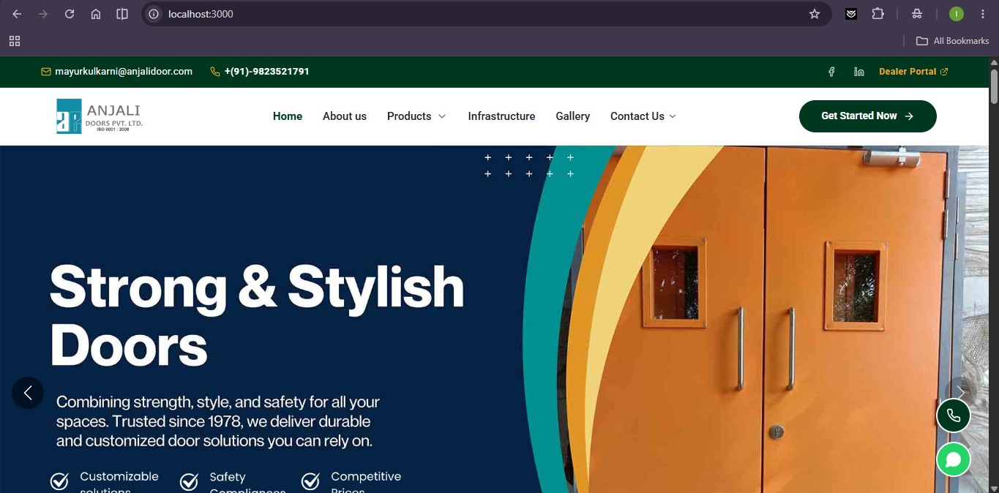
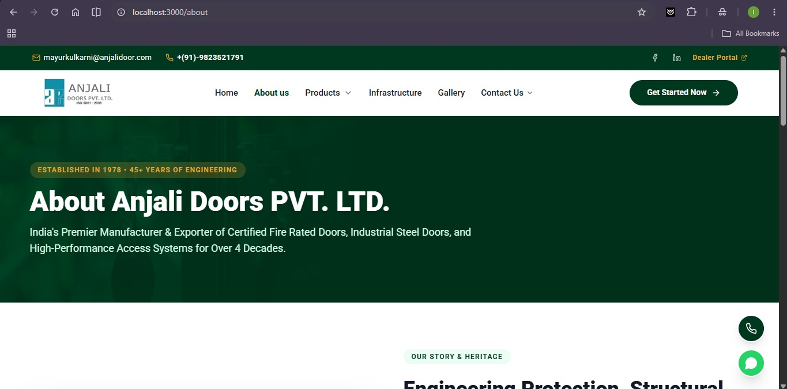
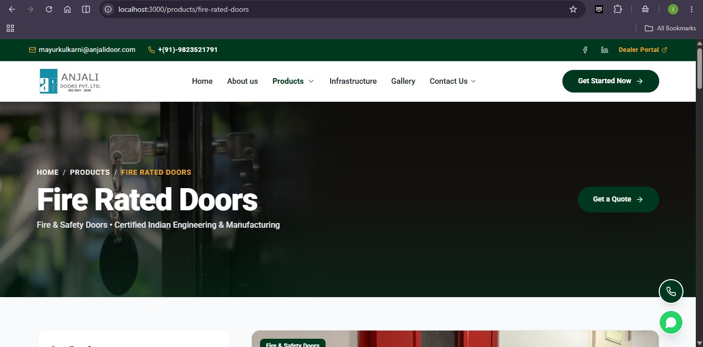
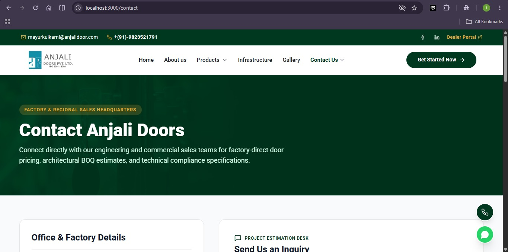

<table width="100%">
  <tr>
    <td width="50%"></td>
    <td width="50%"></td>
  </tr>
  <tr>
    <td width="50%"></td>
    <td width="50%"></td>
  </tr>
</table>

# Anjali Doors Website

A full-stack corporate website for **Anjali Doors PVT. LTD.** (ISO 9001:2008), an Indian manufacturer and exporter of certified fire rated doors, cleanroom doors, industrial steel doors and motorized rolling shutters, operating since 1978 from Boisar (MIDC Tarapur), Maharashtra.

The site presents the company's 24-product catalogue, manufacturing infrastructure and project gallery, and lets visitors send enquiries and quote requests that are delivered by email.

## Tech Stack

| Layer | Technology |
| --- | --- |
| Frontend | Next.js 14 (App Router), React 18, TypeScript |
| Styling | Tailwind CSS 3, `lucide-react` icons |
| Backend | Node.js, Express 4, CORS, dotenv |
| Email | Nodemailer (Gmail SMTP, with Ethereal test fallback in development) |
| Tooling | `concurrently` to run client and server together |

## Features

- **Pages:** Home (hero slider, stats, client logos, testimonials, FAQs), About, Products (search and category filter), Product detail, Infrastructure (CNC, laser cutting and welding machinery), Gallery, Contact and Quality & Safety Policy.
- **Product catalogue:** 24 products across categories such as Fire & Safety, Cleanroom & Pharma, Architectural, Utility Access and Automation doors, each with specs, features and FAQs.
- **Forms:** Contact form, quote request modal and newsletter signup, all sent through the Express API.
- **Quick actions:** Floating call and WhatsApp buttons, Dealer Portal link, downloadable PDF brochure.
- **Responsive UI:** Custom green and gold brand theme built with Tailwind CSS.

## SEO

SEO is implemented on the main pages using Next.js server-rendered metadata:

- **Unique titles and meta descriptions** for Home, About, Contact, Gallery, Infrastructure and every product page.
- **Product-specific SEO data** (`client/src/data/productSeoData.ts`): meta title, description, keywords, image alt/title text and FAQs for each product.
- **Canonical URLs** on every page, pointing to `https://anjalidoor.com`.
- **Open Graph and Twitter Card tags** with 1200x630 share images and `en_IN` locale.
- **JSON-LD structured data (schema.org):** Organization, LocalBusiness/Manufacturer (with address, geo and opening hours), WebSite, ItemList, AboutPage, ContactPage, BreadcrumbList, Product and FAQPage.
- **Static generation** of all product pages via `generateStaticParams` for fast loading.
- **Favicons and touch icons** configured in the root layout, plus `lang="en"` and preconnected Google Fonts.

## Folder Structure

```
Anjali Doors Website/
├── client/                         # Next.js frontend (port 3000)
│   ├── public/
│   │   ├── images/                 # Logos, banners, machinery, client logos
│   │   │   └── products/           # Product photos (one per product)
│   │   ├── ANJALI-DOORS-Brochure.pdf
│   │   └── favicon*, apple-touch-icon.png
│   ├── src/
│   │   ├── app/                    # App Router pages
│   │   │   ├── layout.tsx          # Root layout, global metadata, fonts, icons
│   │   │   ├── page.tsx            # Home (SEO + JSON-LD) -> HomeClient.tsx
│   │   │   ├── about/
│   │   │   ├── products/           # Catalogue + [slug]/ product detail pages
│   │   │   ├── service/[slug]/     # Re-uses the product detail page
│   │   │   ├── infrastructure/
│   │   │   ├── gallery/
│   │   │   ├── contact/
│   │   │   ├── quality-safety-policy/
│   │   │   └── globals.css
│   │   ├── components/             # Header, Footer, HeroSlider, QuoteModal, FloatingActions
│   │   └── data/
│   │       ├── siteData.ts         # Company info, products, machinery, testimonials, FAQs
│   │       └── productSeoData.ts   # Per-product SEO metadata and FAQs
│   ├── tailwind.config.js
│   ├── postcss.config.js
│   ├── tsconfig.json
│   └── package.json
├── server/                         # Express API (port 5000)
│   ├── index.js                    # Routes: health, contact, quote, newsletter
│   ├── services/mailer.js          # Nodemailer setup and email templates
│   ├── .env.example                # Environment variable template
│   └── package.json
├── screenshots/                    # Images used in this README
├── scraped_products.json           # Raw product data collected from the old site
├── formatted_products.json         # Cleaned product data
├── maps_output.txt                 # Google Maps embed links for the two offices
├── package.json                    # Root scripts (run client and server together)
└── README.md
```

## Getting Started

**Prerequisites:** Node.js 18 or later and npm.

1. **Install dependencies**

   ```bash
   npm install
   cd client && npm install
   cd ../server && npm install
   ```

2. **Configure the server** by copying `server/.env.example` to `server/.env` and filling in the values:

   ```env
   PORT=5000
   GMAIL_USER=your_gmail_address
   GMAIL_APP_PASSWORD=your_16_digit_app_password
   ADMIN_EMAILS=comma,separated,recipient,emails
   ```

   If no valid app password is set, the mailer falls back to an Ethereal test account and returns a preview URL instead of sending real emails.

3. **Run both apps** from the project root:

   ```bash
   npm run dev
   ```

   - Frontend: http://localhost:3000
   - API: http://localhost:5000/api/health

## Scripts

| Command | Description |
| --- | --- |
| `npm run dev` | Start client and server together (development) |
| `npm run server` / `npm run client` | Start only the API or only the frontend |
| `npm run build:client` | Create the production build of the frontend |
| `npm start` | Start client and server in production mode |

## API Endpoints

| Method | Endpoint | Purpose |
| --- | --- | --- |
| GET | `/api/health` | Server health check |
| POST | `/api/contact` | Contact enquiry (name, email and phone required) |
| POST | `/api/quote` | Quote request (name, email, phone and door type required) |
| POST | `/api/newsletter` | Newsletter subscription (valid email required) |

## Deployment Notes

- The frontend currently calls the API at `http://localhost:5000`. Update these URLs (Footer, QuoteModal, HomeClient, ContactClient and ProductDetailClient) or move them to an environment variable before going live.
- Keep `server/.env` private and never commit it. Use `.env.example` as the shared template.
- Restrict the CORS `origin` in `server/index.js` to the production domain.

---
 
## 📄 License
 
This project is for personal/portfolio use.
 
---
 
## 👨‍💻 Developer
 
**Soham Aeer**
 
Full Stack Developer · React · Node.js · Express · MERN · DevOps / VPS Deployment
 
- Portfolio: https://soham-aeer-fullstack-portfolio.web.app/
- GitHub: https://github.com/Sohamayer
- LinkedIn: https://www.linkedin.com/in/soham-aeer